# point-in-time-audit

**Finds training features that were not knowable at prediction time, measures the AUC they fabricate, and refuses, with its own exit code, when the schema cannot even pose the question.**

[](https://github.com/lavanyaneela/point-in-time-audit/actions/workflows/ci.yml)
[](https://github.com/lavanyaneela/point-in-time-audit/actions/workflows/ci.yml)
[](LICENSE)

## The contract this repository is about

A feature table joined on entity id cannot say whether a value was knowable at prediction time. The moment a fact became true and the moment it arrived in the warehouse are different timestamps, and the schema usually keeps only one. The leak is therefore unrepresentable in the data a training job reads: no predicate over the columns that exist can exclude it. Everything below is that one sentence, measured and made operational.

Terms are used as follows and nowhere loosened. The *fact time* of an event is when it became true. The *arrival time* is when it landed in a table a pipeline can read. A feature value is *knowable* at a prediction instant only if every event it aggregates has both its fact time and its arrival time at or before that instant. A join is *point-in-time correct* only when its predicates establish knowability. A join that cannot be establishing knowability, because it never mentions an arrival time, is flagged. A table in which knowability is unrepresentable, because no arrival column exists, is refused.

## What the contract costs when it is skipped

The pipeline that passes code review filters on the business timestamp and ignores arrival. On the committed world, that pipeline reads 0.8913 held-out AUC where the honest AUC is 0.7668: **12.45 points of held-out AUC that were never going to appear in production**, never below 11.66 points and up to 14.13 points across 5 paired splits. The same model, the same events, the same splits; the only difference is one missing comparison. Dropping the time predicate entirely and taking the latest value fabricates 17.89 points, and that latest-value join scores 0.9457, which is the version that wins every offline comparison and fails on launch.

The gate that guards against this catches 70.8% of the corpus leak cases: 100.0% of direct sites, every direct join and the unsensored schedule, and none of the leaks that reach a join site through an intermediate table, a CTE, or a sensor that waits on the wrong signal. Those are 3 leak classes the analyzer structurally cannot see, they leave 7 leak cases invisible out of the 24 leak cases in ground truth, and they are published here rather than discovered by a reviewer, because a gate that does not state its own blind spots is a linter making a safety claim.

Credibility line: 239 tests collected (two of them run only under the optional broker and loader services), 98.7% line coverage (the live Kafka consumer runs only against a real broker in an optional CI job and is excluded from the denominator), every figure in this document re-measured by `make verify` and cross-checked against the prose by `tools/check_numbers.py`, which CI proves can fail by breaking a figure on purpose.

## Quickstart

Prerequisites: Python 3.11 or newer and a Java runtime for Spark local mode. No cluster, no credentials, no network.

```
git clone https://github.com/GITHUB_USERNAME/point-in-time-audit
cd point-in-time-audit
pip install -e ".[dev]"
make set-handle HANDLE=your-github-handle   # badges ship as placeholders
make verify        # lint + 239 tests + every number re-measured
make demo          # the audit against this repository's own SQL
pit-audit measure --fixture fixtures/event_log   # the headline number, exit 1
```

## Exit codes are the product

| Code | Meaning |
| --- | --- |
| 0 | No leak detected by any check. |
| 1 | Leak detected. The scan names the offending joins; the measurement names the leaking features with the AUC each fabricates. |
| 2 | **Refused.** The schema has no arrival time column, so knowability is unrepresentable and the question is unanswerable for this table. |
| 3 | Tool error, kept apart from "the answer is no" by a broad handler with a `PIT_AUDIT_DEBUG=1` escape hatch. |

Exit code 2 is the clause the rest of the contract exists to protect. Most leak detectors silently assume the single timestamp they can see is the truth; this one treats that schema as the finding. When a leak and a refusal occur together, the leak wins the exit code because it is actionable now, and the refusal still prints. `pit-audit measure` applies the same contract to data: run against a registry that declares no arrival column and the measurement refuses rather than reporting a number it cannot mean.

## Half one: the leak, measured

A seeded generator produces entity events carrying both timestamps, with configurable arrival delay distributions, across 3,000 entities, with 589 positive outcomes in 119,540 events (ADR-001 is the case for a generator over a public dataset: none records both timestamps). Three pipelines build the same 7 features from the same events and differ only in the admissibility predicate:

| Pipeline | Predicate | Held-out AUC, mean of 5 seeds |
| --- | --- | --- |
| latest value | none | 0.9457 |
| fact time only | `fact_time <= prediction_time` | 0.8913 |
| point in time | `fact_time <= prediction_time AND arrival_time <= prediction_time` | 0.7668 |

The same model trains on each (a histogram gradient boosting classifier; the estimator is deliberately boring because the feature table is the subject). Splits are paired: one seed fixes one entity split, every pipeline is evaluated on it, and the gap is a within-split difference, so the spread published is the spread of the gap itself.

Every feature table is built twice, by a Spark DataFrame job in local mode and by DuckDB executing the committed SQL, and an experiment refuses to publish if the two engines disagree on a single value (ADR-002). The referee rule is not decoration: it caught a real one-hour window error on its first run, documented below.

### Which features leak (E2)

One honest column at a time is swapped for its naive counterpart on an otherwise point-in-time table. Of the 7 features, 3 of them leak materially; the worst offender is incident_count_90d, worth 10.47 points by itself. The fast features buy nothing, and together slightly less than nothing, which is what the mechanism predicts: activity arrives in hours, so admitting its unarrived rows adds no label information, and the four swaps land within about a point of zero on either side of it.

| Feature | Fabricated AUC, points | Mechanism |
| --- | --- | --- |
| incident_count_90d | +10.47 | facts true before prediction, recorded with a 30 day median delay |
| incident_severity_max_90d | +7.71 | same events, the severity view |
| status_risky | +3.95 | corrections written weeks later with backdated fact times |
| the four fast-arriving features | together subtract 1.33 points | arrive in hours to days; each within about a point of zero |

The three leaking features alone sum to 22.13 points; the signed parts sum to 20.8 points once the fast features' small negatives are included; the joint gap of 12.45 is what one model actually recovers. The gap between any of those is interaction, because the leaking features are redundant evidence about the same incidents, and all three numbers are published instead of one being normalised away.

### How much the delay matters (E4)

| Incident delay median, days | Fabricated AUC, points |
| --- | --- |
| 0 | 2.21 |
| 7 | 5.93 |
| 30 (the committed default) | 12.45 |
| 60 | 15.26 |

The gap climbs to 15.26 points at a 60 day median. The uncomfortable row is the first one: with incident delay removed entirely, 2.21 points remain. That residual is the arrival leak the incident knob cannot touch, the backdated corrections and the other delayed dimensions the sweep holds fixed, and the sweep does not decompose it by source. Faster ingestion shrinks the leak; only the arrival predicate removes it. Both engines built every sweep point under the referee rule.

## Half two: the gate, with its miss rate on the label

`pit-audit scan` reads SQL files and Airflow DAG definitions statically. At any query scope that references both a registered prediction table and a registered event table, it requires a bare arrival-before-prediction conjunct. Predicates it cannot certify, a UDF, a CASE, a BETWEEN, are flagged rather than trusted, and that choice has a price it pays in public: the corpus holds 3 correct predicates wrapped in shapes the analyzer declines to read, it flags 3 of them, and E3 records that as the precision cost of refusing to guess. Across the 10 cases whose ground truth is clean, those three are the only flags; on the 7 clean cases written with bare predicates there are 0 false positives, a measured zero that bounds that narrower rate only below 34.8% at 95 percent confidence; the sample says no more and neither does this document.

The schema registry declares, per table, which column is the fact time and which is the arrival time. A joined table the registry does not list, with no visible provenance, is refused. A listed table with no arrival column is refused with the sentence this repository exists for. The registry is how the analyzer avoids the trap of guessing that `updated_at` means anything at all.

### What it structurally cannot see (E3)

Against the 36 corpus cases whose ground truth is declared in `fixtures/leak_corpus/expected.yaml`, the analyzer catches 70.8% of the corpus leak cases and names 17 of them, all 17 direct sites (every direct join plus the unsensored schedule), misses 7 cases, and the misses are not tuning failures. They are the opening impossibility reappearing one level up:

| Blind class | Why it is invisible | Detection |
| --- | --- | --- |
| intermediate table | the naive join is upstream; the consumption site reads a clean looking table with no event table in scope | 0 of 3 |
| CTE relay | the same hole at query grain | 0 of 3 |
| wrong sensor semantics | a sensor that waits on a row count has the same structure as one that waits on an arrival watermark | 0 of 1 |

Relay sites are never certified: the scan prints an out-of-scope notice naming the event ancestry it can trace, so silence is not mistaken for approval. The DAG analyzer reads Airflow source with `ast`, never importing it, threads task SQL through one lineage in schedule order, and enforces the property SQL cannot carry: a training task must sit downstream of an arrival completeness sensor, because clean SQL executed before the facts have landed is a leak with no SQL in it.

### When this tool stops being the right tool

`pit-audit pivot` computes the trigger condition for the deliberately out-of-scope feature. At the measured direct catch rate, the crossover sits at 50.0% of temporal joins routed through intermediate tables: past that share, undetected leak sites outnumber detected ones, static analysis is the wrong tool, and the fix is structural, which is arrival time as a first class column that a feature store enforces. That computed number is the roadmap; a wish list is not.

## The dialects, held to one answer (E5)

The feature builds and four audit queries compile from one spec to 28 committed SQL files across DuckDB, Spark, Snowflake and BigQuery dialects. Every file parses under its own grammar. The Spark texts, the feature build and all four audit queries, execute on a real local Spark session; the Snowflake and BigQuery texts execute by transpilation onto DuckDB; and 3 of 3 dialects reproduce the reference, the feature table and the audit rows, value for value. The hosted warehouses are never contacted; the boundary table below says exactly what that does and does not establish. The portable lesson is the point: the point-in-time contract is two comparisons that spell the same in every dialect, and the reason pipelines ship without them is not syntax.

## The bugs the measurement found

**The referee pair earned its keep in its first hour.** The first cross-engine parity run disagreed on the activity window features for a subset of entities, Spark consistently larger. The cause was not the as-of logic. `INTERVAL 30 DAY` on a timezone-aware timestamp is calendar arithmetic in the session timezone, DuckDB inherits the session timezone from the runner, and on this runner that was America/New_York, so every window spanning the 2025-03-09 spring forward transition was one hour short. On the committed world the broken session clips 20 windows; entity 139 loses one activity event sitting 26.0 minutes inside the lost hour, worth 16.59965 of summed value. The fix pins both engines to UTC, where a day is 86400 seconds on every day of the year, and the test that proves the fix re-runs the broken session so it would fail against the bug it fixes. The dialect SQL inherits whatever session timezone a warehouse gives it, so the same hazard is documented beside the SQL (`docs/failure-modes.md`).

**The ground truth corpus convicted the analyzer before it convicted any SQL.** The analyzer's first corpus run returned zero findings on every SQL case: a dependency had renamed the argument that holds a query's FROM clause, the analyzer read the old name, saw no relations in any scope, and certified nothing because it saw nothing. Twenty one expectations missed, every one a silent pass. The corpus was written before the analyzer first ran, which is the only reason a broken gate did not look like a quiet one (the files were committed after the debugging they enabled, so the commit order understates their age), and the regression test that pins the fix asserts the corpus run produces findings at all.

**The first committed world was a planted answer key, and E2 said so.** Backdated corrections originally fired for most positives and never for negatives, so one feature carried the entire gap as a near copy of the label. The attribution table is what made that legible, the world was recalibrated so corrections are evidence rather than answers, and the episode is kept in the history because a measurement that can convict its own fixture is the measurement worth trusting.

## Architecture



The source is kept beside the rendered file in `docs/diagrams/architecture.mmd`.

## Operational notes

- `make verify` is the single promise: lint, the full suite, and every published figure re-measured, offline, from a fresh clone.
- The committed event log is Kafka shaped: topic, partition, per partition offsets in arrival order, key and timestamp, because offset order is arrival order and arrival order is the information a warehouse schema drops. A non blocking CI job round trips the fixture through a real single node broker and holds the consumed payload to the manifest's content hash; nothing here claims anything about a broker under load.
- The Airflow DAG is real and its structure is pinned by tests; a scheduler is not executed (ADR-003). The DAG's own last word is `pit-audit scan` over the pipeline's SQL and the DAG folder, so the pipeline gates itself.
- The audit runs in CI as a composite action (`action.yml`); wire `pit-audit scan` into any workflow and branch on the four exit codes.
- Run the dialect SQL in a UTC session. The daylight saving failure above is a property of session timezone arithmetic, not of DuckDB.
- The registry is the one file to keep honest. The analyzer refuses rather than guesses, so an unregistered table is friction on purpose.

## What this repository deliberately does not claim

| Boundary | Statement |
| --- | --- |
| Snowflake and BigQuery execution | The dialect texts parse under their own grammars and execute by transpilation onto DuckDB. The warehouses are not contacted. |
| Databricks runtime | The Spark job is written the way a Databricks job is written and runs in local mode. The runtime is not exercised. |
| Airflow scheduler | The DAG parses and its structure is tested. No scheduler executed it. |
| Kafka under load | A job exists that round trips the fixture through a real broker. Throughput, retention and rebalancing are unmeasured. |
| Real arrival delays | The delay distributions are chosen, not observed (ADR-005). In production the arrival process is often not recorded at all, which is exactly why exit code 2 exists. |
| An adversarial author | The analyzer flags what it cannot certify, so it is not bypassed by obfuscation, but a leak routed through tables it never sees is invisible, and E3 measures that instead of denying it. |

## Repository map

```
src/point_in_time_audit/   generator, event log, feature engines, measurement, analyzer, CLI
sql/                       28 committed SQL files, four dialects, regenerated by make sql
fixtures/event_log/        the committed world, manifest pinned
fixtures/leak_corpus/      36 corpus cases with declared ground truth
dags/                      the pipeline DAG that gates itself
experiments/               E1 to E5, outputs committed under docs/experiments/
tools/                     collect_metrics, check_numbers, check_durations, emitters
docs/adr/                  the five decisions with their costs attached
```

## License

MIT, copyright Lavanya Neela.
